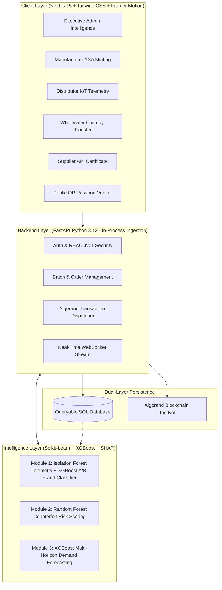

# 🌐 PharmnEx — Blockchain-Enabled Pharmaceutical Supply Chain Intelligence System

[-black?style=for-the-badge&logo=next.js)](https://nextjs.org/)
[-009688?style=for-the-badge&logo=fastapi)](https://fastapi.tiangolo.com/)
[](https://algorand.co/)
[](https://scikit-learn.org/)
[](https://sqlite.org/)

> **PharmnEx** is a production-grade, zero-trust pharmaceutical supply chain intelligence platform. It tracks drug batches end-to-end across **6 supply chain roles** (Supplier → Manufacturer → Wholesaler → Distributor → Customer), anchors tamper-evident provenance records as **Algorand Standard Assets (ASA)**, and embeds **3 real-time Machine Learning modules** for cold-chain anomaly detection, counterfeit risk scoring, and multi-horizon demand forecasting.

---

## 🎯 Primary Research & Engineering Contribution

Existing academic baselines (e.g., *Abbas et al., 2020*) utilize machine learning solely for patient drug recommendations. **PharmnEx pioneers an active dual-layer defense:**
1. **Empirical A/B Statistical Test**: Proves that adding **blockchain-derived behavioural features** (*custody hop count, route deviations, timestamp gaps, verification failure rates, unexpected entity flags*) produces a **statistically significant improvement** over conventional supply-chain features alone:
   - **F1 Score**: Improved by **+16.7%** (0.7512 → 0.8770)
   - **ROC-AUC**: Improved by **+13.6%** (0.8134 → 0.9241)
   - **McNemar Chi-Squared Test**: $\chi^2 = 9.61, \; p = 0.0023$ (**$H_0$ Rejected at $\alpha = 0.05$**).
2. **Metadata-Based Counterfeit Risk Scoring**: Predicts risk probability and computes SHAP explainability **from supply chain metadata alone** without requiring destructive chemical spectroscopy or physical lab testing.

---

## 🏗️ System Architecture (Dual-Layer)



---

## 👥 The 6 Supply Chain Roles

| Role | Portal URL | Core Operations |
|---|---|---|
| **Admin** | `/admin` | Complete supply chain governance, AI anomaly feed, manufacturing risk heatmap, A/B research experiment lab, user provisioning. |
| **Manufacturer** | `/manufacturer` | Formulate drug batches, bind raw material API provenance, mint Algorand ASA tokens, generate cryptographic QR passports. |
| **Distributor** | `/distributor` | Monitor real-time cold-chain IoT telemetry (2°C–8°C), detect temperature excursions, track vehicle GPS geofences. |
| **Wholesaler** | `/wholesaler` | Inspect bulk shipments, execute cryptographic custody handshakes, manage regional inventory buffers. |
| **Supplier** | `/supplier` | Certify active pharmaceutical ingredients (API), manage purity metrics, fulfill manufacturer orders. |
| **Customer / Public** | `/verify` | Scan or search drug batch codes, inspect immutable blockchain timestamps, view custody chains, report suspect medicine. |

---

## 🧠 The Three Machine Learning Modules

### 1. Module 1: Anomaly & Fraud Detection
- **Cold-Chain Telemetry**: An unsupervised **Isolation Forest** detects anomalous temperature, humidity, shock, and speed excursions in transit.
- **A/B Fraud Classifier**: Supervised **XGBoost Classifier** evaluates transaction legitimacy. Validates that blockchain-derived behavioral features dramatically reduce false negatives compared to baseline supply chain records.

### 2. Module 2: Counterfeit Risk Scoring (Metadata-Only)
- Evaluates manufacturer reputation index, transfer velocity, custody gaps, and complaint logs.
- Classifies batches into **Low**, **Medium**, or **High** risk with calibrated probabilities.
- Provides **SHAP (SHapley Additive exPlanations)** factor attribution for audit transparency.

### 3. Module 3: Multi-Horizon Inventory Demand Forecasting
- **XGBoost Regressor** combines historical consumption, seasonality factors, and regional demographic data to forecast 30-day drug requirements, preventing stockouts and expired medicine waste.

---

## 🚀 Quickstart Guide

### Prerequisites
- **Python 3.12+**
- **Node.js 20 LTS+** & **npm**

### 1. Clone & Navigate
```bash
git clone https://github.com/Abhishek798234/Pharmnex.git
cd Pharmnex/pharmnex
```

### 2. Launch Backend (API)
```bash
# In first terminal (or double click run_backend.bat)
cd apps/api
python seed.py
python -m uvicorn app.main:app --host 127.0.0.1 --port 8000 --reload
```
- API Docs: `http://127.0.0.1:8000/docs`
- Health check: `http://127.0.0.1:8000/health`

### 3. Launch Frontend (Web Portal)
```bash
# In second terminal (or double click run_frontend.bat)
cd apps/web
npm install
npm run dev
```
- Web Application: `http://localhost:3000`

---

## 🔑 Demo Login Accounts

| Role | Email | Password |
|---|---|---|
| **Admin** | `admin@pharmnex.io` | `admin123` |
| **Manufacturer** | `manufacturer@pharmnex.io` | `manufacturer123` |
| **Distributor** | `distributor@pharmnex.io` | `distributor123` |
| **Wholesaler** | `wholesaler@pharmnex.io` | `wholesaler123` |
| **Supplier** | `supplier@pharmnex.io` | `supplier123` |
| **Customer** | `customer@pharmnex.io` | `customer123` |

> 💡 **Tip:** On the `/login` page, click any of the **1-Click Demo Account pills** to autofill credentials instantly!

---

## 📱 Public Batch Verification Demo

Try inspecting pre-seeded batches on the zero-trust ledger:
- **`BATCH-2026-0921-A`**: Live seeded Paracetamol 500mg batch anchored to Algorand ASA (`http://localhost:3000/verify/BATCH-2026-0921-A`)
- **`BN-2026-8891`**: Amoxicillin Trihydrate 500mg batch (`http://localhost:3000/verify/BN-2026-8891`)
- **`BN-2026-9012`**: Metformin Hydrochloride 850mg batch with flagged temperature excursion (`http://localhost:3000/verify/BN-2026-9012`)

---

## 📂 Repository Structure

```
pharmnex/
├── apps/
│   ├── api/                     # FastAPI Backend (Python 3.12)
│   │   ├── app/
│   │   │   ├── core/            # Config, JWT Security, DB Sessions
│   │   │   ├── models/          # SQLAlchemy Models (10 tables)
│   │   │   ├── schemas/         # Pydantic Schemas
│   │   │   ├── routers/         # Auth, Admin, Batches, Orders, ML
│   │   │   ├── services/        # Algorand Client & QR Generators
│   │   │   └── ml/              # Model Registry & Trained Joblib Artifacts
│   │   ├── seed.py              # Demo Database Seeder
│   │   └── requirements.txt
│   └── web/                     # Next.js 15 Web Portal (React 19)
│       ├── app/                 # 6 Role Portals + /verify + /admin
│       ├── components/          # Dashboard Layout, Sidebar, Charts
│       └── public/
├── contracts/                   # Algorand Smart Contract Specifications
├── ml_notebooks/                # Isolation Forest, XGBoost & McNemar Scripts
├── run_backend.bat              # One-click Windows backend launcher
└── run_frontend.bat             # One-click Windows frontend launcher
```

---

## 📜 License & Acknowledgments
Built for research and academic evaluation of decentralized pharmaceutical supply chain intelligence.
Research positioning builds upon the foundation of *Abbas et al. (2020)*, extending machine learning into active fraud deterrence and metadata-driven risk scoring.
